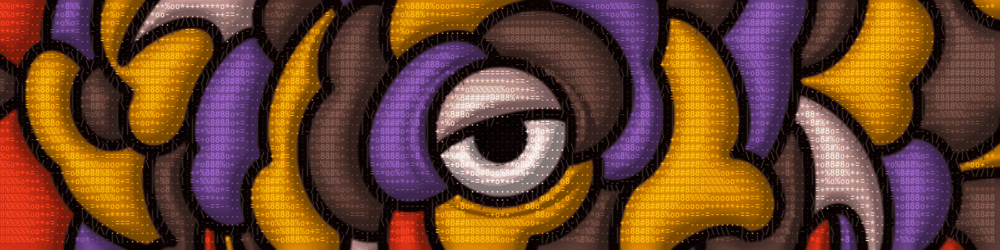
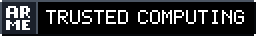
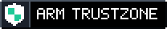
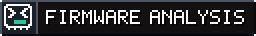
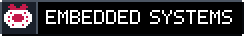
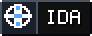
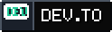

 
 

  <b>Exploring the boundaries of trusted execution and system-level security.</b>

 

---

###  Research Interests

  
  
  
  
  

 

###  Tech Stack

  
  
  
  
  
   
  
  
  
  
  

 

###  Contact

  
  
  

 
